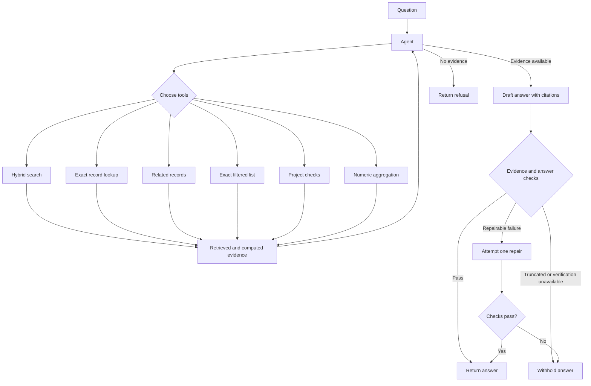

# construction-rag

A retrieval-augmented question-answering system for construction project records. It searches RFIs, submittals, change events, daily reports, and punch items, then generates answers with references to the evidence used.

The project is a single-operator prototype built with Python, PostgreSQL, and pgvector. It combines retrieval, structured queries, deterministic calculations, and answer checks. These checks reduce some failure modes but do not guarantee that an answer is correct.

## Features

- **Hybrid retrieval:** combines keyword and vector search using Reciprocal Rank Fusion, with exact-ID handling and metadata filters.
- **Connected records:** follows explicit and shared relationships between project records.
- **Exact queries and calculations:** lists records using supported filters and delegates supported totals, counts, and overdue checks to code.
- **Evidence and citations:** tracks returned records, submittal revisions, calculations, and the source snapshot used for a question.
- **Answer checks:** checks references and selected figures, and can verify passages against cited evidence before returning an answer.
- **Evaluation:** includes offline tests, retrieval checks, and live question sets for measuring answer quality and withholding.

## Get started

### Requirements

- Python 3.14 and Docker with Docker Compose
- An Anthropic API key for answers
- An OpenAI-compatible embeddings API key for the PostgreSQL index

### Setup

Clone the sample records and pin the version used by the evaluation sets:

```bash
git clone https://github.com/constructelligence-lab/construction-project-records data/records
git -C data/records checkout 7e0e2ac4ed7e5c54c34ff24bd19506f0316ca7ac
```

Create the Python environment and install the project:

```bash
python3 -m venv .venv
source .venv/bin/activate
pip install -r requirements-dev.txt
pip install -e . --no-deps
```

Copy the configuration file and set `ANTHROPIC_API_KEY`, `EMBED_API_KEY`, and `RAG_DB_PASSWORD`:

```bash
cp .env.example .env
```

Start PostgreSQL, apply the migrations, and ingest the sample project:

```bash
docker compose up -d --wait db
python -m rag.db.migrate
python -m rag.cli.ingest
```

Ingestion creates embeddings and may incur API costs. Re-run it when the source CSVs or record rendering change; unchanged record text is not embedded again.

### Ask a question

```bash
python -m rag.cli.main --as-of 2026-09-20 "Which RFIs are overdue and what do they hold up?"
```

Search without generating an answer:

```bash
python -m rag.cli.main --search-only "abandoned conduit"
```

The `--store memory` option uses an in-memory index and, without an embeddings key, an offline hashing embedder. It does not require PostgreSQL, but answer generation still requires an Anthropic API key.

## How it works



The agent selects tools for the question and receives their results as data. Record citations identify returned evidence; submittal citations include a revision, and `CALC-` references identify checker or aggregate results. A model-based verifier checks passages against cited evidence in the default `enforce` mode. It is experimental and can make mistakes; `--verifier-mode shadow` records its verdict without blocking, and `--verifier-mode off` disables it.

Ingestion saves a content-hashed copy of the source CSVs with the index. The CLI uses that snapshot for checks and compares the PostgreSQL snapshot generation before and after a question. If ingestion commits during the question, the CLI discards the result and asks for a retry. This assumes writes go through the ingestion path.

## Evaluation

Run the offline checks with:

```bash
make check
```

This runs Ruff, mypy, and the unit and integration tests. Unit tests require no API keys or network calls. Database integration tests use a separate local test database and are skipped when PostgreSQL is unavailable; CI requires the database.

Run the retrieval evaluation without model calls:

```bash
python -m evals.retrieval_eval
```

The robustness runner captures answers, evidence, and diagnostic traces for review. It calls paid APIs when configured with real embeddings:

```bash
python -m evals.run_robustness --suite v2 --real-embeddings --output evals/results/robustness-v2-run.jsonl
```

Results can contain project data and are stored locally. See [the evaluation guide](evals/data/robustness_candidates.md) for the question set and review criteria.
The [baseline guide](evals/baselines/README.md) explains the saved historical results and how to rescore them offline.

In the latest recorded blind run before subsequent changes, the system delivered 12 answers to 30 questions; 11 delivered answers were graded factually correct against the source records. The other 18 were not graded, and the grader did not check each claim against its citation. This is one run on one sample project, not a production accuracy estimate. The latest changes have not been measured in a new live run.

## Repository structure

| Path | Purpose |
| --- | --- |
| `src/rag/records/` | CSV loading, chunking, relationships, and source snapshots |
| `src/rag/storage/` | Store interface, PostgreSQL and in-memory stores, keyword search |
| `src/rag/retrieval/` | Hybrid search and result ranking |
| `src/rag/agent/` | Tool definitions, execution, and the agent loop |
| `src/rag/answering/` | Answer prompts, evidence, citation and claim checks, verification |
| `src/rag/providers/` | Chat and embedding providers |
| `src/rag/infra/` | Resilience and telemetry |
| `src/rag/cli/` and `src/rag/db/` | Command-line entry points, database connection, and migrations |
| `tests/` and `evals/` | Offline tests, question sets, and evaluation runners |

## Security and limitations

Tool results are treated as untrusted data. Questions use a read-only database connection, and the agent has limits on model steps, tool calls, and result sizes. Timeouts and retries are bounded by the request budget where supported, but the budget is not a hard wall-clock guarantee.

The verifier can reject correct answers or accept unsupported ones. Complete-list results are limited in size, and custom callers are responsible for maintaining a consistent snapshot. The project does not provide multi-user authentication or authorization. See [security notes](docs/security.md) for the threat model and remaining risks.

## Sample data attribution

The evaluation questions and recorded outputs refer to sample project records from [Constructelligence](https://github.com/constructelligence-lab/construction-project-records). The source repository licenses its sample data under [CC BY 4.0](https://creativecommons.org/licenses/by/4.0/). This project adapts that data into evaluation questions and results; the source records are cloned separately during setup.

## License

The project code is available under the [MIT License](LICENSE). The separately sourced sample records are subject to their own license, described above.
